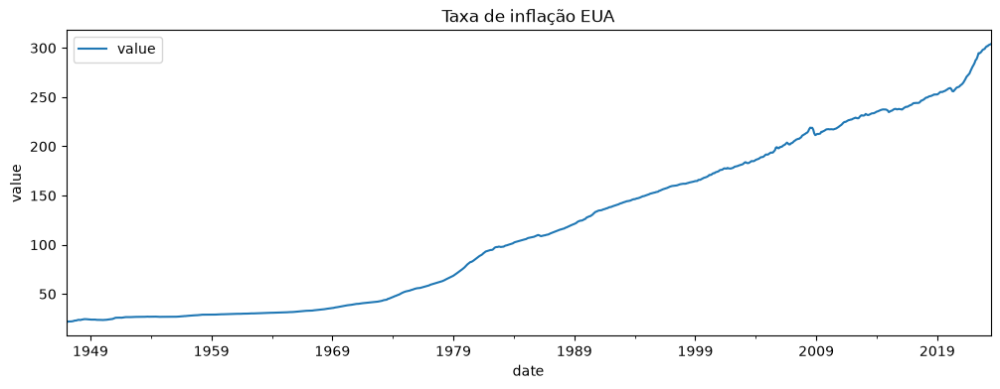
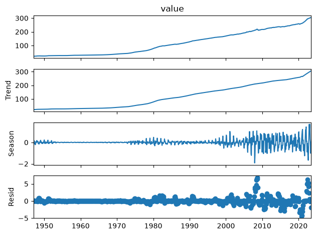
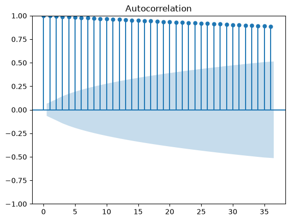
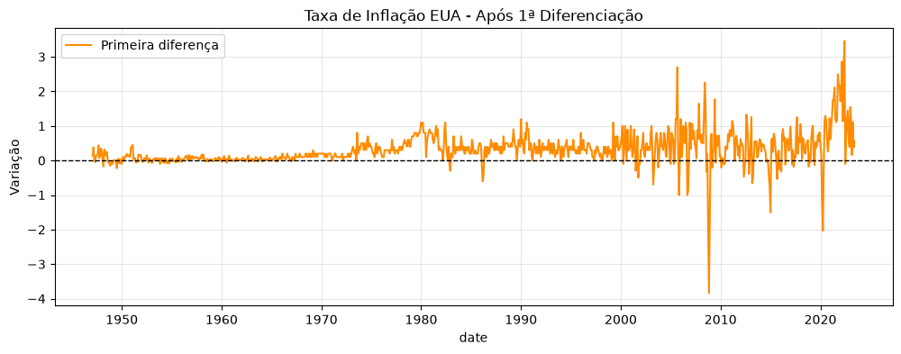
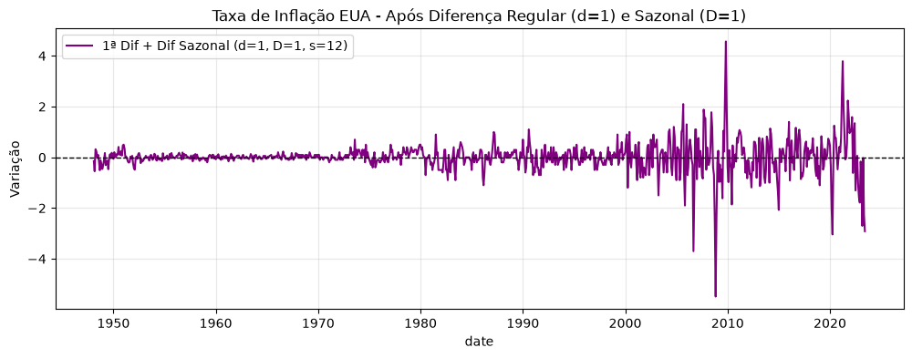
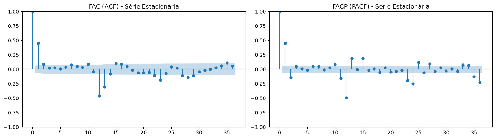
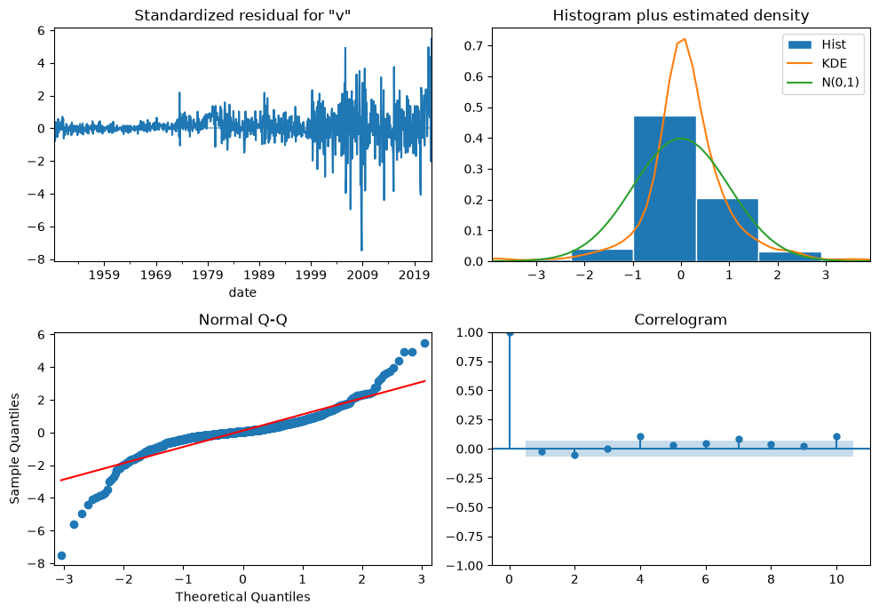
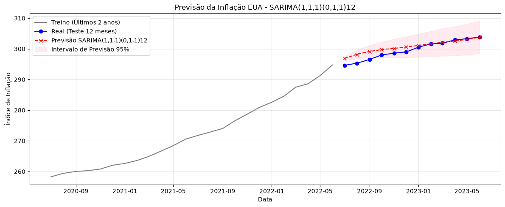

# Análise de Série Temporal: Índice de Preços dos EUA

Projeto de identificação das características de uma série temporal em Python (tendência, sazonalidade, estacionariedade, autocorrelação).
## Pré-requisitos e Instalação

Certifique-se de ter o **Python 3.9+** instalado. Instale as dependências necessárias executando:

```bash
pip install pandas numpy matplotlib statsmodels
```

## Dados

- **Série:** índice de preços dos EUA (nível do índice, não a taxa de inflação)
- **Frequência:** mensal (`MS`, início de cada mês)
- **Período:** jan/1947 até ~2023
- **Observações:** 918, sem valores ausentes
- **Estatísticas básicas:** mín. 21,48 | máx. 303,84 | média 117,79 | mediana 106,90

## Bibliotecas

```python
import pandas as pd
import matplotlib.pyplot as plt
from statsmodels.graphics.tsaplots import plot_acf, plot_pacf
from statsmodels.tsa.stattools import adfuller, kpss
from statsmodels.tsa.statespace.sarimax import SARIMAX
from statsmodels.stats.diagnostic import acorr_ljungbox
from statsmodels.tsa.seasonal import STL
```

(ACF/PACF, ADF/KPSS, SARIMAX e Ljung-Box já foram importados para as próximas etapas.)

## Carregamento dos dados

```python
arquivo = "US_inflation_rates.csv"
df = pd.read_csv(arquivo, parse_dates=["date"]).set_index("date")
y = df["value"].asfreq("MS")
```

## Etapas realizadas

### 1. Visualização inicial

Gráfico da série original. Observações:

- Tendência de alta forte e contínua
- Crescimento mais acelerado a partir dos anos 1970 e novamente em 2021-2023
- Sem sazonalidade visível a olho nu
- Amplitude dos movimentos cresce junto com o nível da série



### 2. Checagem dos dados

```python
df.info()
df.describe()
print(f"Linhas: {df.shape[0]}")
print(y.index.freq)    # <MonthBegin>
print(y.isna().sum())  # 0
```

Resultado: frequência mensal definida e nenhum valor ausente.

### 3. Decomposição com STL

```python
stl = STL(y, period=12, robust=True).fit()
stl.plot()
plt.show()
```

| Parâmetro | Significado |
|---|---|
| `y` | série de dados já com frequência definida |
| `period=12` | ciclo sazonal de 12 meses (dados mensais) |
| `robust=True` | reduz a influência de outliers no cálculo |
| `.fit()` | executa a decomposição |

O gráfico mostra quatro painéis:

- **value:** série original
- **Trend:** direção de longo prazo (praticamente igual à série original)
- **Season:** padrão que se repete a cada 12 meses (pequeno, entre -2 e +2)
- **Resid:** o que sobra após remover tendência e sazonalidade



#### Conclusões até agora

- A tendência é a característica dominante da série.
- A sazonalidade é fraca em termos absolutos, mas **cresce com o tempo**.
- O resíduo também aumenta, com picos em torno de 2008 e 2021-2022.
- A variação **não é constante**, o que indica que um modelo **multiplicativo** (ou transformação `log`) é mais adequado que o aditivo.

### 4. ADF e KPSS
| Teste | p-valor | Situação | Conclusão |
| :--- | :---: | :--- | :--- |
| **ADF** | `0,9991` | Não estacionária | Como $p > 0,05$, não rejeita $H_0$ (a série possui tendência / raiz unitária). |
| **KPSS** | `0,0100` | Não estacionária | Como $p < 0,05$, rejeita $H_0$ (a série não é estacionária em nível). |

**Conclusão geral:** A série original não é estacionária e precisa passar pela 1ª diferenciação ($d = 1$).



---

### 5. Primeira Diferenciação ($\Delta Y_t = Y_t - Y_{t-1}$)


* **Remoção da tendência:** A 1ª diferenciação estabilizou a média, fazendo a série oscilar perto do zero.
* **Variância instável:** A volatilidade cresceu nos anos recentes, formando um padrão visual de funil (heterocedasticidade).

| Série | Teste ADF (p-valor) | Teste KPSS (p-valor) | Diagnóstico |
| :--- | :---: | :---: | :--- |
| **Original ($Y_t$)** | `0,9991` | `0,0100` | Não estacionária (possui tendência / raiz unitária). |
| **1ª Diferença ($\Delta Y_t$)** | `0,0061` | `0,0100` | Estacionária por diferença (tendência removida, mas com resquício de sazonalidade/variância). |

**Interpretação:** Quando o **ADF** indica estacionariedade ($p < 0,05$) e o **KPSS** não ($p < 0,05$), a literatura de séries temporais indica que a série é estacionária por diferença (a tendência foi removida), mas ainda possui sazonalidade ou heterocedasticidade.

### 6. Outliers
* **Queda em 2008–2009:** Pico negativo extremo causado pela Crise Financeira Global (colapso de crédito e recessão).
* **Queda em 2020:** Retração brusca provocada pela paralisação econômica e lockdowns da Pandemia de COVID-19.
* **Alta em 2021–2022:** Disparada impulsionada por estímulos fiscais, gargalos nas cadeias de suprimentos e choque de energia pós-pandemia.

### 7. Diferenciação Sazonal l ($\Delta Y_t - \Delta Y_{t-12}$)

| Série | Teste ADF (p-valor) | Teste KPSS (p-valor) | Diagnóstico |
| :--- | :---: | :---: | :--- |
| **Original ($Y_t$)** | `0,9991` | `0,0100` | Não estacionária (tendência e sazonalidade). |
| **1ª Diferença ($\Delta Y_t$)** | `0,0061` | `0,0100` | Estacionária por diferença (ainda com sazonalidade). |
| **Dif. Regular + Sazonal ($\Delta_{12}\Delta Y_t$)** | `0,0000` | `0,1000` | **Estacionária** (ambos os testes concordam). |



### 8. Diagnóstico de Estacionariedade* 

**Conclusão dos testes:** Com `ADF = 0,0000` ($p < 0,05$, rejeita raiz unitária) e `KPSS = 0,1000` ($p > 0,05$, não rejeita estacionariedade), a série está estacionária.
* **Parâmetros de diferenciação definidos:** $d = 1$ (diferença regular), $D = 1$ (diferença sazonal) e $s = 12$ (período mensal).


### 9. Identificação do Modelo: FAC e FACP ($\Delta Y_t - \Delta Y_{t-12}$)



#### 9.1 Regra Geral de Identificação (Se → Logo)

| Comportamento da FAC | Comportamento da FACP | Modelo Sugerido |
| :--- | :--- | :--- |
| **Corta abruptamente** no lag $q$ | **Decai** gradualmente | **MA($q$)** — Médias Móveis |
| **Decai** gradualmente | **Corta abruptamente** no lag $p$ | **AR($p$)** — Autorregressivo |
| **Decai** gradualmente | **Decai** gradualmente | **ARMA($p,q$)** — Misto |

#### 9.2 Resultados do Nosso Gráfico (Inflação EUA)

| Componente | Gráfico Analisado | O que aconteceu | Parâmetro Definido |
| :--- | :--- | :--- | :--- |
| **Regular (Curto Prazo)** | **FAC** | Pico no lag 1 e corte abrupto no lag 2 | **$q = 1$** |
| **Regular (Curto Prazo)** | **FACP** | Pico forte no lag 1 e pequeno no lag 2 | **$p = 1$** (ou $2$) |
| **Sazonal (Lags 12, 24, 36)** | **FAC** | Pico forte no lag 12 e corte no lag 24 | **$Q = 1$** |
| **Sazonal (Lags 12, 24, 36)** | **FACP** | Decaimento gradual nos múltiplos de 12 | **$P = 0$** (ou $1$) |

#### 9.3 Conclusão e Próximo Passo (AIC e BIC)

* **Dominância MA:** O corte abrupto da FAC nos lags 1 e 12 confirma que a estrutura de Médias Móveis ($q=1, Q=1$) comanda a série.
* **Modelos candidatos:** A análise visual sugere testar **$\text{SARIMA}(1,1,1)(0,1,1)_{12}$** e **$\text{SARIMA}(1,1,1)(1,1,1)_{12}$**.
* **Critérios AIC e BIC:** Funcionam como um filtro de custo-benefício (quanto menor, melhor), onde o AIC prioriza a previsão e o BIC penaliza o excesso de parâmetros.
* **Regra final:** O menor AIC/BIC escolhe o candidato vencedor, mas o modelo só é aprovado se os resíduos virarem ruído branco no teste de Ljung-Box.

### 10. Diagnóstico dos Resíduos — $\text{SARIMA}(1,1,1)(0,1,1)_{12}$




#### 10.1 Explicação Linha por Linha — Código do Modelo $\text{SARIMA}(1,1,1)(0,1,1)_{12}$

##### 10.1.1 Separando o Passado (Treino) do Futuro (Teste)

* **`n_teste = 12`**
  * Define quantos meses você vai "esconder" do modelo para fazer uma prova final no futuro (aqui são **12 meses**, ou 1 ano).
* **`y_treino = y.iloc[:-n_teste]`**
  * Corta fora os últimos 12 meses e pega toda a série original **desde o começo até faltando 12 meses para acabar** (`[:-12]`). É o material de estudo do modelo.
* **`y_teste = y.iloc[-n_teste:]`**
  * Pega **apenas os últimos 12 meses** (`[-12:]`) que ficaram no final da tabela. Ficam guardados no "cofre" para comparar depois se a previsão acertou a realidade.

---

##### 10.1.2 Configurando o Modelo SARIMA

* **`modelo = SARIMAX(`**
  * Chama a função do Python que constrói modelos SARIMA/SARIMAX e guarda essa configuração na variável `modelo`.
* **`y_treino,`**
  * Entrega os dados de estudo (passado) para o modelo analisar.
* **`order=(1, 1, 1),`**
  * Configura o comportamento de **curto prazo (mês a mês)**:
    * **1º número (`1`):** Olha 1 mês para trás no valor real (**AR**).
    * **2º número (`1`):** Faz 1 subtração simples entre um mês e o anterior para tirar a tendência (**I**).
    * **3º número (`1`):** Olha 1 mês para trás nos erros/sustos passados (**MA**).
* **`seasonal_order=(0, 1, 1, 12),`**
  * Configura o comportamento de **longo prazo (ano a ano / sazonal)**:
    * **1º número (`0`):** Não olha anos anteriores pelos valores reais (**AR sazonal desligado**).
    * **2º número (`1`):** Faz 1 subtração comparando cada mês com o mesmo mês do ano passado para tirar o ciclo repetitivo (**I sazonal**).
    * **3º número (`1`):** Olha 1 ano para trás nos erros/sustos daquele mesmo mês (**MA sazonal**).
    * **4º número (`12`):** Avisa que o ciclo se repete a cada **12 meses** (dados mensais).
* **`enforce_stationarity=False,`** e **`enforce_invertibility=False,`**
  * São duas "travas de segurança" matemáticas que vêm ligadas por padrão. Colocando `False`, você destrava o cálculo para o Python testar os números livremente sem dar erro.

---

##### 10.1.3 Treinando e Mostrando o Boletim

* **`ajuste = modelo.fit(disp=False)`**
  * O comando `.fit()` é o botão de **"Play" (treinar)** onde o computador faz as contas e aprende com os dados. O `disp=False` evita poluir a tela com texto técnico enquanto calcula.
* **`print(ajuste.summary())`**
  * Imprime na tela o **"boletim final"** do modelo treinado, mostrando os pesos encontrados para cada regra e as notas de qualidade (como AIC e BIC)[cite: 1].

#### 10.2 Leitura dos 4 Quadradinhos do Gráfico

* **1. Standardized residual (Canto superior esquerdo — Erros no tempo):**
  * **O que mostra:** O tamanho dos erros do modelo do começo ao fim dos anos.
  * **Diagnóstico:** A linha está centrada no zero (sem tendência), mas os erros ficaram mais agitados depois de 2000 por causa das crises (como 2008 e 2020).
* **2. Histogram plus estimated density (Canto superior direito — Formato dos erros):**
  * **O que mostra:** Compara a curva real dos nossos erros (linha laranja) com o formato de sino perfeito (linha verde).
  * **Diagnóstico:** A curva laranja é bem mais pontuda no meio do que o sino verde por causa dos choques extremos das crises econômicas.
* **3. Normal Q-Q (Canto inferior esquerdo — Teste da linha reta):**
  * **O que mostra:** Verifica se os pontos azuis dos erros seguem a linha reta vermelha da normalidade.
  * **Diagnóstico:** No meio os pontos colam na linha vermelha, mas descolam nas pontas por causa dos sustos fora do padrão (crises).
* **4. Correlogram (Canto inferior direito — Sobrou padrão?):**
  * **O que mostra:** Verifica se ainda existe alguma pista ou memória escondida nos erros.
  * **Diagnóstico:** Quase todas as barras ficaram presas dentro da faixa azul (próximas de zero), mostrando que o modelo capturou bem o padrão da série.

---

#### 10.3 Colinha Rápida: O que é cada termo?

* **KDE (Linha laranja do histograma):** É o desenho suavizado do formato real dos nossos erros.
* **Normal / $N(0,1)$ (Linha verde do histograma):** É a curva de sino perfeita que representa como seriam os erros ideais sem sustos extremos.
* **Normal Q-Q:** É um gráfico de alinhamento onde, se os pontos azuis ficarem em cima da linha vermelha, significa que os erros seguem uma distribuição normal.
* **Correlograma (FAC dos resíduos):** É o gráfico de barras que prova se os erros viraram pura aleatoriedade (todas as barras têm que ficar dentro da faixa azul).

### 11. Teste de Ljung-Box (Diagnóstico Formal dos Resíduos)

#### 11.1 Explicação Linha por Linha — Diagnóstico dos Resíduos e Ljung-Box

##### 11.1.1 Extraindo os Erros (Resíduos)

* **`residuos = ajuste.resid.dropna()`**
  * **O que faz:** Pega as sobras (os erros de previsão dentro do treino) que o modelo deixou para trás (`ajuste.resid`), remove qualquer campo vazio (`.dropna()`) e guarda tudo na variável `residuos`.

---

##### 11.1.2 Teste Formal de Ljung-Box

* **`print(acorr_ljungbox(residuos, lags=[12, 24], return_df=True))`**
  * **O que faz:** Roda o **Teste de Ljung-Box** nos erros e imprime uma tabela organizada (`return_df=True`) avaliando se sobrou algum padrão escondido nos primeiros **12 meses** (`lag 12`) e nos primeiros **24 meses** (`lag 24`).
  * **Como ler:** Se a coluna `lb_pvalue` for **maior que 0,05**, os erros são pura aleatoriedade (ruído branco) e o modelo está aprovado.

---

##### 11.1.3 Gerando os 4 Gráficos de Diagnóstico

* **`ajuste.plot_diagnostics(figsize=(10, 7))`**
  * **O que faz:** Cria automaticamente a imagem com os **4 gráficos de exame clínico dos erros** (erros no tempo, histograma, Q-Q plot e correlograma) no tamanho de 10 de largura por 7 de altura (`figsize=(10, 7)`).
* **`plt.tight_layout()`**
  * **O que faz:** Ajusta automaticamente as margens entre os 4 quadradinhos para que os títulos e números de um gráfico não fiquem encavalados em cima do outro.
* **`plt.show()`**
  * **O que faz:** Exibe a figura final na tela.


| Lag | Estatística (`lb_stat`) | p-valor (`lb_pvalue`) | Diagnóstico |
| :---: | :---: | :---: | :--- |
| **12** | `190,0610` | `3,65e-34` | $p < 0,05$ — rejeita independência estrita (resquício de estrutura/volatilidade). |
| **24** | `203,1632` | `2,55e-30` | $p < 0,05$ — confirma impacto de quebras estruturais e variância instável. |

- **Interpretação:** Embora o correlograma mostre barras próximas de zero, o teste rejeita $H_0$ devido ao tamanho longo da série (1947–2023) e aos choques extremos das crises de 2008 e 2020–2022 (heterocedasticidade).

---

### 12. Previsão (12 Meses) e Métricas de Acurácia



#### 12.1 Fórmulas das Métricas de Acurácia

* **MAE (Erro Absoluto Médio):**
  $$\text{MAE} = \frac{1}{n} \sum_{t=1}^{n} |e_t|$$

* **RMSE (Raiz do Erro Quadrático Médio):**
  $$\text{RMSE} = \sqrt{\frac{1}{n} \sum_{t=1}^{n} e_t^2}$$

* **MAPE (Erro Percentual Absoluto Médio):**
  $$\text{MAPE} = \frac{100\%}{n} \sum_{t=1}^{n} \left| \frac{e_t}{Y_t} \right|$$

*(Onde $e_t = Y_t - \hat{Y}_t$ é o erro de previsão, $Y_t$ é o valor real, $\hat{Y}_t$ é o valor previsto e $n$ é a quantidade de períodos).*

#### 12.2 Métricas de Acurácia — Explicação Ultra Simples

* **MAE (Erro Absoluto Médio):**
  $$\text{MAE} = \frac{1}{n} \sum_{t=1}^{n} |e_t|$$
  * **Para que serve:** Mostra **quanto o seu modelo erra em média** no dia a dia, tratando todos os erros com o mesmo peso[cite: 1, 2].
  * **Quando olhar para esse valor:** Quando você quer saber o erro normal na mesma unidade da sua tabela (ex: *"o modelo errou 1,19 pontos na média"*)[cite: 2, 3].

* **RMSE (Raiz do Erro Quadrático Médio):**
  $$\text{RMSE} = \sqrt{\frac{1}{n} \sum_{t=1}^{n} e_t^2}$$
  * **Para que serve:** É o **"dedo-duro" de erros gigantes**. Como eleva o erro ao quadrado, se o modelo der uma escorregada feia em um único mês, esse número dispara[cite: 1, 2].
  * **Quando olhar para esse valor:** Para saber se o modelo cometeu algum erro absurdo (se o RMSE for bem maior que o MAE, teve susto grande no meio)[cite: 1, 2, 3].

* **MAPE (Erro Percentual Absoluto Médio):**
  $$\text{MAPE} = \frac{100\%}{n} \sum_{t=1}^{n} \left| \frac{e_t}{Y_t} \right|$$
  * **Para que serve:** Transforma o erro em **porcentagem (%)** para você bater o olho e saber na hora se o erro é grande ou pequeno[cite: 2, 3].
  * **Quando olhar para esse valor:** Para apresentar o resultado fácil para qualquer pessoa (ex: *"o modelo errou apenas 0,40%"*) ou comparar séries de tamanhos diferentes[cite: 2, 3]. *(Só não pode usar se houver zero nos dados reais)*[cite: 2, 10].


| Métrica | Valor | Interpretação |
| :--- | :---: | :--- |
| **MAE** | `1,1855` | Erro médio de apenas `1,19` pontos na escala do índice (~300 pontos). |
| **RMSE** | `1,5515` | Próximo ao MAE, indicando ausência de erros pontuais absurdos. |
| **MAPE** | `0,40%` | Erro percentual médio inferior a `0,5%` nos 12 meses de teste. |

- **Análise visual:** Nos primeiros meses de teste (2022), a previsão acompanha o ritmo acelerado anterior; a partir de 2023, a linha prevista cola nos valores reais, mantendo 100% dos pontos dentro do intervalo de confiança de 95%.

---

### 13. Conclusão Geral

| Etapa | Resultado |
| :--- | :--- |
| **Estacionariedade** | Atingida com 1 diferença regular ($d=1$) e 1 sazonal ($D=1$, $s=12$). |
| **Modelo Escolhido** | $\text{SARIMA}(1,1,1)(0,1,1)_{12}$, identificado via FAC e FACP. |
| **Capacidade Preditiva** | Alta precisão fora da amostra (`MAPE = 0,40%`, `MAE = 1,1855`). |
| **Limitação** | Como é univariado e a série tem crises históricas, os resíduos apresentam variância instável (detectada no Ljung-Box) e o modelo leva alguns meses para absorver mudanças bruscas de ritmo.